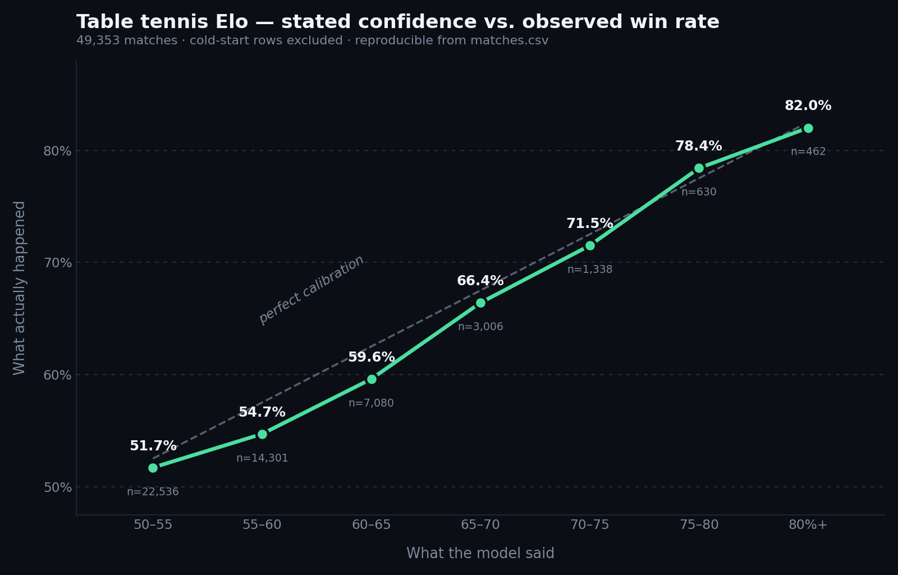

# Table Tennis Pre-Match Elo Ratings

51,397 table tennis matches where every row carries the Elo ratings of **both
players as they stood before the match was played**, together with the model's
pre-match win probability. No look-ahead leakage, so the file is usable in a
backtest exactly as shipped.

This repository holds a **free 2,000-row sample**, the data dictionary, and a
notebook that verifies the model's calibration from scratch, with confidence
intervals.



## The claim, and how to check it

When the model states a confidence, that is roughly how often it wins. Measured
across 49,353 matches of the full file, cold-start rows excluded:

| Model said | Matches | Actually won | Gap |
|---|---|---|---|
| 50–55% | 22,536 | 51.7% | −0.8 |
| 55–60% | 14,301 | 54.7% | −2.8 |
| 60–65% | 7,080 | 59.6% | −2.9 |
| 65–70% | 3,006 | 66.4% | −1.1 |
| 70–75% | 1,338 | 71.5% | −1.0 |
| 75–80% | 630 | 78.4% | +0.9 |
| 80%+ | 462 | 82.0% | — |

Every bounded band lands within 2.9 points of its stated confidence. The 80%+
band is open-ended, so it has no midpoint to compare against.

Scoring, on the full file:

```
model            Brier 0.2435
always 50/50     Brier 0.2500
base rate        49.95% (no side bias to exploit)
```

On a clean 13,892-match holdout never used for fitting or calibration, the
set-level model scores **0.2428** against **0.2480** for a classic match-level
Elo at K=32. A full Glicko-2 was tested and rejected at 0.2540.

Run [`notebooks/01_calibration_check.ipynb`](notebooks/01_calibration_check.ipynb)
to reproduce the calibration curve from the sample in this repo. On the sample,
**6 of 7 confidence bands are statistically consistent with perfect calibration**;
the seventh is not distinguishable either way at that sample size.

Prefer to run it without installing anything? The same notebook runs on Kaggle
against the same file:
[dataset](https://www.kaggle.com/datasets/thierryseverinlamien/table-tennis-pre-match-elo-ratings-sample)
 · [notebook](https://www.kaggle.com/code/thierryseverinlamien/is-this-table-tennis-elo-model-actually-calibrated)

## Quick start

```python
import pandas as pd

m = pd.read_csv("data/tt_ratings_sample_2000.csv", parse_dates=["date"])
m[["date", "league", "elo_a_pre", "elo_b_pre", "p_model", "winner"]].head()
```

## Schema

`matches.csv` — 13 columns:

| Column | Type | Meaning |
|---|---|---|
| `match_id` | string | Opaque match id, unique |
| `date` | date | Match day, `YYYY-MM-DD` |
| `league` | string | Competition (69 distinct values) |
| `player_a`, `player_b` | string | Opaque player ids, stable across files |
| `elo_a_pre`, `elo_b_pre` | float | Elo **before** the match |
| `sol_a_pre`, `sol_b_pre` | float | Solidity index before the match — share of wins by 2+ sets |
| `p_model` | float | Model probability that A wins, computed pre-match |
| `winner` | `A`/`B` | Actual winner |
| `sets_a`, `sets_b` | int | Set score |

Full definitions for all four CSVs in
[`DATA_DICTIONARY_EN.md`](DATA_DICTIONARY_EN.md) (English) and
[`DATA_DICTIONARY.md`](DATA_DICTIONARY.md) (French, original).

## How the rating works

Elo computed at the **set** level rather than the match level: updated once per
set, weighted by the point margin within that set. A 3–0 and a 3–2 are the same
result to a match-level Elo; they are plainly not the same performance.

The match probability is derived from the set rating, then adjusted by a
*solidity* differential (a player's share of clean 2+ set wins) with weights
learned by logistic regression. Parameters `k = 3, α = 1`, tuned by
rolling-origin cross-validation over four folds.

## Releases

The dataset is rebuilt and republished **every 10 days**, larger each time. A
purchase gives you the release that exists on that day, permanently, under a
commercial license — it does not expire. Future releases are sold separately;
there is nothing else on sale today.

## What is in the sample vs. the full dataset

|  | Sample (here) | Full dataset |
|---|---|---|
| Matches | 2,000 | 51,397 |
| Players file | — | 1,662 players |
| Weekly rating history | — | 8 weeks, all players |
| Calibration table | — | included |
| Methodology document | — | included |

The full file covers **25 June to 20 August 2026** — 57 days of play across 69
competitions, of which four make up 95.6%: TT Elite Series (16,254 matches),
Setka Cup (16,157), Czech Liga Pro (8,768), TT Cup (7,978).

**Full dataset:** https://lathiselam.gumroad.com/l/tt-ratings

Use code `LAUNCH10` for $10 off while the file is still two months long — early
buyers get a smaller dataset than later ones, so they pay less.

## Honest limits

- Two months of data in the current release. Enough to backtest a model and
  study rating dynamics; not enough to say anything about seasonality yet. The
  window widens with each 10-day release.
- 623 matches (1.2%) of the full file are cold-start rows where both players sit
  at the opening 1500 rating and `p_model` is exactly 0.500. Filter with
  `m[(m.elo_a_pre != 1500) & (m.elo_b_pre != 1500)]`.
- The **+0.0052 Brier** gain is measured against a match-level Elo at K=32. The
  methodology also shows K=32 is not the optimum for that baseline, so the edge
  over a fully tuned match-level Elo is smaller than that and is not quantified.
  This is a well-built input to a model, not an edge in a box.
- Calibration is global. Some high-variance leagues show residual over-confidence
  at the top end; it is documented rather than smoothed away.

## License

The 2,000-row sample in this repository is free to use, including commercially.
The full dataset ships under a single-user commercial license: use it in your
own models, research and products, but do not redistribute or resell the raw files.
